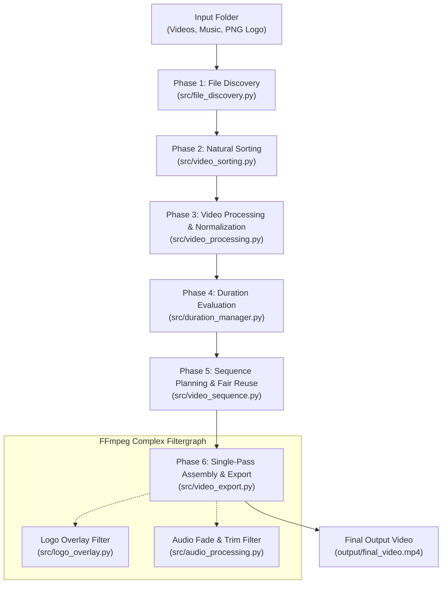

# System Architecture & Component Design

The **Automated Video Editing Application** (`auto_montage`) is architected with strict modularity, single-responsibility principles, and high performance. It avoids loading uncompressed media into system memory by orchestrating FFmpeg streaming processes through Python.

---

## 1. High-Level Pipeline Architecture

The execution pipeline transitions through six distinct phases:



---

## 2. Component Breakdown

Each module in `src/` owns an isolated concern:

### `src/file_discovery.py`
- **Responsibility:** Directory ingestion and asset categorization.
- Scans input directory for candidate files matching valid extensions:
  - Videos: `.mp4`, `.mov`, `.avi`, `.mkv`, `.webm`, `.flv`, `.wmv`, `.m4v`.
  - Audio: `.mp3`, `.wav`, `.aac`, `.m4a`, `.flac`, `.ogg`, `.wma`.
  - Logo: `.png`.
- Excludes auxiliary text or prompt files (`.txt`, `.json`, `.srt`, etc.).
- Enforces strict business validations (minimum 1 video, exactly 1 music track, exactly 1 PNG logo if logo overlay is enabled).

### `src/video_sorting.py`
- **Responsibility:** Natural numerical sorting and gap detection.
- Extracts filename prefix and numerical suffix (e.g., `gfl1`, `gfl2`, ..., `gfl10`).
- Groups clips sharing common prefixes together.
- Sorts items within each prefix group by natural integer ordering (`vid1`, `vid2`, `vid3`, ..., `vid10`, avoiding lexical `vid10` before `vid2`).
- Identifies missing sequence numbers (e.g. detected `[1, 2, 4]` logs a warning for missing index `3`).
- Provides natural alphanumeric sorting fallback for non-numbered filenames.

### `src/video_processing.py`
- **Responsibility:** Slow-motion conversion, audio stripping, and format normalization.
- Adjusts presentation timestamps (PTS) based on `slow_motion_speed` via `setpts=(1/speed)*PTS`.
- Completely removes source audio (`-an`).
- Normalizes canvas resolution (default: `1920x1080`), frame rate (`30 FPS`), and pixel aspect ratio (`setsar=1`).
- Implements aspect ratio adaptation:
  - `pad`: Preserves source geometry, pads remaining canvas with black borders.
  - `crop`: Preserves source geometry, fills canvas and crops excess edges from center.
- Employs MD5-based metadata caching in `temp/` to prevent re-processing identical source videos on subsequent runs.

### `src/duration_manager.py`
- **Responsibility:** Duration extraction and deficit calculation.
- Probes background music duration with millisecond accuracy.
- Calculates single-pass footage duration from processed clips.
- Determines whether Stage 2 (random video reuse) is needed, and quantifies the deficit:
  $$\Delta t_{\text{needed}} = \max(0, T_{\text{music}} - T_{\text{seq}})$$

### `src/video_sequence.py`
- **Responsibility:** Multi-stage playlist generation.
- **Stage 1 (Sequential Playback):** Every source video is queued once in numerical order.
- **Stage 2 (Fair Random Reuse):** If additional footage is required:
  - Implements a fair shuffle-bag algorithm so every video has an opportunity to be reused before repeats.
  - Enforces a non-consecutive rule: clip $i$ never equals clip $i-1$.
  - Trims strictly the final clip to bridge the remaining millisecond gap to match music duration.

### `src/logo_overlay.py`
- **Responsibility:** Logo geometry, boundary clamping, and alpha blending.
- Computes scaled dimensions preserving natural aspect ratio based on `width_percent` and `max_width_px`.
- Calculates pixel offsets for positions: `top-left`, `top-right`, `bottom-left`, `bottom-right`, `center`.
- Enforces boundary clamping so logos never exceed canvas edges:
  $$x_{\text{clamped}} = \max(0, \min(W_{\text{canvas}} - W_{\text{logo}}, x))$$
- Preserves full alpha channel transparency through `format=auto`.

### `src/audio_processing.py`
- **Responsibility:** Background music filters and audio transitions.
- Discards all original clip audio.
- Applies `atrim` and `asetpts` to match target duration.
- Generates `afade` filter expressions for configurable fade-in and fade-out envelopes.
- Encodes audio as high-bitrate AAC (`192k`, stereo, 48 kHz).

### `src/video_export.py`
- **Responsibility:** Single-pass FFmpeg concat demuxing and container export.
- Assembles an FFmpeg concat demuxer playlist (`temp/concat_playlist.txt`).
- If the final clip requires trimming, generates an intra-frame-accurate trimmed segment.
- Chains video concat, logo overlay filtergraph, and audio track into a single FFmpeg command.
- Avoids intermediate uncompressed re-encodings, ensuring maximum rendering speed and zero generation loss.

### `src/utils.py`
- **Responsibility:** System binary discovery, execution wrappers, and logging.
- Probes FFmpeg and FFprobe across config paths, `static-ffmpeg`, system `PATH`, and standard platform directories.
- Features automatic fallback to `ffmpeg -i` stderr parsing if `ffprobe` is not installed.
- Centralizes structured logging to both standard output and `logs/video_editor.log`.

---

## 3. Data Flow Diagram

```text
[Input Directory]
       │
       ├── Video Files (*.mp4, *.mov, ...)  ──> [Video Processor] ──> [temp/normalized_clips/*.mp4]
       │                                                                      │
       ├── Music File (*.mp3, *.wav, ...)   ──> [Duration Manager]            │
       │                                              │                       │
       └── PNG Logo (*.png)                           ▼                       │
                                            [Sequence Builder] <──────────────┘
                                                      │
                                                      ├──> [temp/concat_playlist.txt]
                                                      │
                                                      ▼
                                            [Video Exporter]
                                                      │
                                            (FFmpeg Filter Complex)
                                                      ├── Concat Video Streams
                                                      ├── Overlay PNG Logo
                                                      └── Trim & Fade Music Audio
                                                      │
                                                      ▼
                                         [output/final_video.mp4]
```
